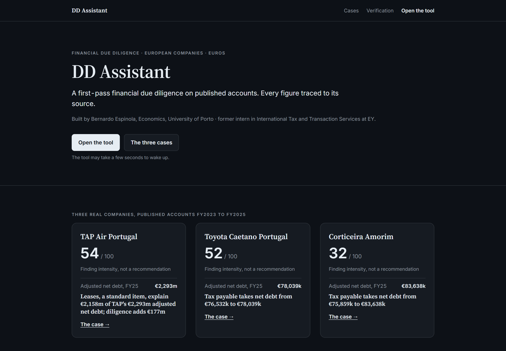

# DD Assistant

**A first-pass financial due diligence on published accounts, with every figure traced to its source.**

[](https://mitchell1970.github.io/dd-assistant/)
[](https://dd-assistant-tickmark.streamlit.app/?company=tap)
[](https://github.com/MItchell1970/dd-assistant/raw/main/docs/examples/tap/databook.xlsx)

[](https://mitchell1970.github.io/dd-assistant/)

## What it does

1. Reads a data room as the seller sends it (Excel, PDF, Word, or a listed company's ESEF filing) in six national formats, and keeps each figure's file and cell or XBRL tag.
2. Before using any figure, it rebuilds the published subtotals from the lines it read. A missing figure stays unknown and is never treated as zero.
3. Runs 30 red-flag rules from transaction services, private equity and credit practice. Each finding comes with its evidence, the amount at stake, the question for management and the document to request.
4. Builds the bridges a deal team asks for first: quality of earnings, net debt with debt-like items, working capital against an indicative peg, and EV to equity.
5. Exports an Excel databook with live formulas, a Red Flag Report in slides and a prioritised request list. Claude writes the two-page memo, and a checker with no AI checks every figure in it.

The [website](https://mitchell1970.github.io/dd-assistant/) shows the conclusions on three Portuguese companies (TAP Air Portugal, Toyota Caetano, Corticeira Amorim, FY2025). The [demo](https://dd-assistant-tickmark.streamlit.app) shows the evidence. Nothing is uploaded and no AI is called in the demo.

## How it is verified

| Figure | What it is | Proof |
|---|---|---|
| **317** | automated tests, all passing | `python -m unittest` |
| **30** | rules, each with its threshold, source and plain-language reason | `python -m dd_assistant --rules` |
| **100%** | of the 123 lines read on the three companies carry their source cell, page or tag | `CompanyData.sources` |
| **414** | memo figures checked against the material, 0 without a source | [`docs/examples/`](docs/examples/) |
| **10 of 10** | published subtotals rebuilt from the lines read | `tests/test_real_companies.py` |
| **48 of 49** | planted distortions detected, one at a time | [`docs/DETECTION.md`](docs/DETECTION.md) |
| **0** | false alarms on the clean test company | `tests/test_clean_company.py` |
| **27 of 27** | databook totals where Excel's recalculation equals Python | `tests/test_databook.py` |

The method, the rules, the layers and what is not measured yet are in [`docs/ARCHITECTURE.md`](docs/ARCHITECTURE.md).

## Run it

Windows, PowerShell, inside a virtual environment (`py -m venv .venv`, then `.venv\Scripts\Activate.ps1`):

```powershell
pip install -r requirements.txt
python -m unittest
streamlit run app.py
```

`python -m dd_assistant data\Duriva_data_room` runs the same analysis from the command line, and `$env:DD_DEMO=1` before `streamlit run` opens the public demo locally.

## Limits

- Annual accounts only: no monthly figures, LTM or budget, so the working capital peg is indicative.
- Euros only: statements in another currency are refused, never converted.
- Financial due diligence only: no legal, tax, commercial, IT or HR review, and no valuation.
- It gives an analyst a first pass to review and never makes an investment recommendation.
- The real accounts tested so far are Portuguese. Spanish, French, German and Italian layouts are tested only on synthetic statements. Open gaps: [`docs/GAPS.md`](docs/GAPS.md).

## Repository

```
app.py            Streamlit app (local upload; public demo with DD_DEMO=1)
dd_assistant/     the engine: reading, metrics, rules, deal view, databook, memo and its checker
scripts/          data builders, the static site, the detection benchmark, review captures
tests/            parity with the Excel template, real companies, detection, site and tool
data/             published accounts, the fictitious Duriva and Velmora data rooms
docs/             ARCHITECTURE · DETECTION · DEPLOY · PROGRESS · GAPS
docs/examples/    stored results: memos, checks, databooks, slides, validation
docs/archive/     earlier phase specifications and reviews
site/             the static website (GitHub Pages)
```

## Built by

Bernardo Espinola, a final-year Economics student at FEP (University of Porto), after an internship in International Tax and Transaction Services at EY. I wrote the scope, the rules and their thresholds, and checked the results against the published accounts. The code was written with Claude Code from my specifications. [LinkedIn](https://www.linkedin.com/in/bernardo-mitchell-de-arvellos-espinola/)

Licensed under the [MIT License](LICENSE).
