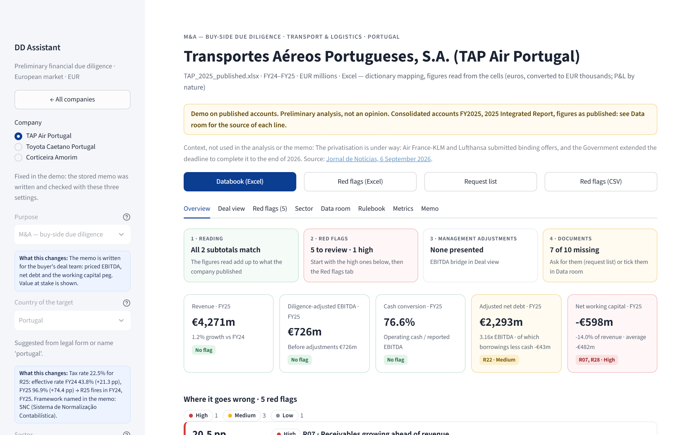
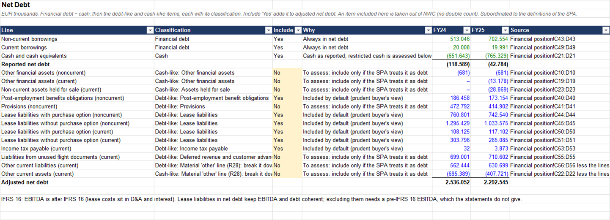
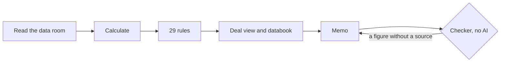

# DD Assistant

**A first-pass financial due diligence on published accounts: every figure traced to its source.**

[](https://dd-assistant-tickmark.streamlit.app)

**Live demo:** <https://dd-assistant-tickmark.streamlit.app> — three real companies on their published FY2025 accounts; no upload, no AI call. Direct links: [TAP Air Portugal](https://dd-assistant-tickmark.streamlit.app/?company=tap) · [Toyota Caetano Portugal](https://dd-assistant-tickmark.streamlit.app/?company=toyota-caetano) · [Corticeira Amorim](https://dd-assistant-tickmark.streamlit.app/?company=corticeira-amorim).

It reads a company's statements (Excel, PDF, Word or an ESEF filing), checks its own reading against the published subtotals, and returns what a deal team asks for first: quality of earnings, net debt with debt-like items, working capital, 29 red-flag rules with their sources, a two-page memo, the request list and an Excel databook with live formulas. European companies, euros only.



*The online demo on TAP Air Portugal's published FY2025 accounts: both reading checks pass, adjusted net debt is €2,293m (3.16x EBITDA) although cash exceeds bank borrowings by €43m, and each card is coloured by the red flags behind it.*



*The databook in Excel, as a transaction team receives it: data room figures in blue with their source cell, the analyst's decisions in the yellow cells, and totals that Excel recalculates and the code checks.*

## What it found

Three Portuguese companies, on their latest published consolidated accounts (FY2025, with FY2024 comparatives). The engine computed every figure; each is in the stored memo, which passed the automatic checker.

| Company | Finding | Source |
|---|---|---|
| **TAP Air Portugal** | On the balance sheet TAP holds more cash than bank debt: borrowings less cash are -€43m in FY25. Count the leased aircraft (IFRS 16) and pensions, and net debt is **€2,293m**, 3.16x EBITDA. Leases also make EBITDA look bigger: €726m, but €262m after lease payments. | Statement of financial position, 2025 Integrated Report p.152 (four lease liability lines) |
| | The effective tax rate was **96.9%** in FY25, against 22.5% statutory (R25): income tax of €66m on profit before tax of €68m. | Income statement, p.153 |
| **Toyota Caetano Portugal** | Other income is **60.5% of FY25 EBITDA**: €40,036k of €66,187k (R04, High). | Income statement, 2025 annual report (ESEF), "Outros rendimentos operacionais" |
| | Operating cash flow turned negative: **-€3,987k** in FY25 against €62,857k in FY24 (R10), as inventories grew 25.8% against COGS up 4.5% (R09). | Cash flow statement and balance sheet, 2025 annual report |
| **Corticeira Amorim** | Revenue fell 8.3%, yet operating cash flow was **155.4% of EBITDA** (€219,015k), as inventories fell from €466,545k to €388,297k. No rule fires; the memo asks whether it will repeat. | Cash flow statement and balance sheet, 2025 annual report (ESEF) |
| | Debt due within 12 months fell from **56.3% to 28.7%** (R11 on FY24), and cash in the cash flow statement is net of €29,451k of bank overdrafts. | Statement of financial position and note 19 |

Each company has a memo, the checker's result, the databook and a one-page case note in [`docs/examples/`](docs/examples/).

## How it works

1. **Read:** every Excel, PDF, Word and ESEF file of the data room, with a six-language dictionary of statement lines; each figure keeps its file and cell, or its XBRL tag.
2. **Calculate:** margins, cash conversion, working capital days, net debt and leverage, in deterministic Python. A missing figure stays unknown, never zero.
3. **Rules:** 29 rules from Big Four due diligence, private equity and bank credit practice, each with its threshold, evidence, source, question for management and document to request.
4. **Deal view:** reported to diligence-adjusted EBITDA, reported to adjusted net debt, and working capital with an indicative peg; then enterprise value to equity, once you enter the price mechanism.
5. **Verified memo:** Claude writes the memo and the request list from that material only; a checker with no AI confirms every figure, for the year it is cited, and every finding.



## How it is verified

- **192 automated tests** (`python -m unittest`), run on every change.
- **Parity with a hand-built Excel template:** the Python gives exactly the template's metrics, rule values, thresholds and severities.
- **Published totals rebuilt:** on each real company, the subtotals rebuilt from the lines read must equal the published ones, and the balance sheet must balance. Operating profit is rebuilt to the euro for TAP and Toyota Caetano; EBITDA is within the report's own €2k rounding for Corticeira Amorim.
- **No false alarm on a clean company:** a fictitious company designed to pass raises no finding.
- **Memo checker:** every figure of the memo must be in the material, for the period cited; every finding must appear; every question needs a request; no investment-recommendation language. The three demo memos pass with 89, 78 and 85 figures checked, none without a source.
- **Databook:** recalculated by Excel, every total equals the Python value.
- On the five sets of real accounts, the 27 findings are classified as 15 true positives, 12 to review and no known false alarm ([`docs/VALIDATION.md`](docs/VALIDATION.md); a classification proposed by the agent, not yet reviewed by me).

## Limits

- Annual accounts only: no monthly figures, LTM or budget, so the working capital peg is indicative.
- Euros only: statements in another currency are refused, never converted.
- Financial due diligence only: no legal, tax, commercial, IT or HR review, and no valuation.
- A first pass for an analyst to review: it points to what to investigate and never gives an investment recommendation or a view on price.
- The real accounts tested so far are Portuguese; Spanish, French, German and Italian layouts are tested on synthetic statements.

## Built by

I am Bernardo Espinola, a final-year Economics student at FEP (University of Porto). I built this as a personal project after an internship in International Tax and Transaction Services at EY in Porto, where I supported buy-side and sell-side due diligence work. Contact: [LinkedIn](https://www.linkedin.com/in/bernardo-mitchell-de-arvellos-espinola/).

- **My part:** the scope and the method, the rules and their thresholds, the deal view bridges, the choice of companies, and checking the results against the published accounts.
- **AI's part:** the code was written with Claude Code from my specifications, and every change runs against the tests above. The demo memos were written by Claude Code with this project's skill, then checked by the code.
- **What I learned:** to turn due diligence practice into explicit rules a machine can test, to trace every number to its source, and to use AI where it helps (reading, drafting) while the calculations stay deterministic and checked.

---

# Details

## What it does

Drop a target's data room as the seller sends it — a folder of Excel statements, PDFs and Word documents — and get, in seconds, the first pass of a financial due diligence. It is built for the European market:

- euros only;
- statements in the national formats: Portuguese SNC, Spanish PGC, French PCG, German HGB, Italian civil code, and IFRS in English.

The focus is M&A, buy-side or vendor due diligence. The same analysis also serves a lender's credit review or a health check with no transaction.

What the agent does:

- **Reads the whole data room.** Excel files are read together as one set of statements, every figure keeping its file and cell. PDFs, Word and text documents (management report, audit report, contracts) are read as text for the memo, free and on your computer, and the key-document checklist is ticked from what is there. Statements that exist only as a PDF are read by Claude, on request.
- **Reads ESEF filings.** Every listed company in the EU files its annual report in iXBRL (ESEF), with each figure tagged with its IFRS meaning. Drop the report package (.zip, from [filings.xbrl.org](https://filings.xbrl.org) or the company's website) and every line is read from its tag, exact and free: the company's own lines are understood through their ESEF anchoring to IFRS, and each figure keeps its tag as its source (`ifrs-full:Revenue`).
- **Understands every line.** "Vendas e serviços prestados", "Importe neto de la cifra de negocios", "Chiffre d'affaires", "Umsatzerlöse", "Ricavi delle vendite" and "Revenue" are all revenue. It handles European number, date and unit formats (1.234,5 · 31.12.2024 · TEUR · miles de euros), income statements by nature or by function, and subtotals placed before or after their lines.
- **Checks its own reading.** It rebuilds gross profit, EBITDA and operating profit from the lines it read and compares them with what the company published. A mismatch means a line is missing, and the agent says so.
- **Builds the deal view**, the numbers a deal team asks for first:
  - quality of earnings: reported → management-adjusted → diligence-adjusted EBITDA;
  - net debt, with the debt-like and cash-like items it finds: pensions, TFR, tax payable, leases, shareholder loans, marketable securities;
  - net working capital, with an indicative peg reference.
- **Bridges to the price.** You choose the mechanism of the SPA first; nothing is computed before. Completion accounts: EV + eligible cash − financial debt − debt-like items + (NWC at closing − peg). Locked box: the agreed equity price + value accrual or ticking fee − leakage confirmed after review. Dividends paid in the cash flow statement are listed as leakage candidates, never as a verdict. Sensitivity to the multiple and EBITDA only when EV is derived from a multiple you enter.
- **Exports a databook**, the Excel a transaction team works in: Read Me, Executive Summary, Source Register (every file with its SHA-256), Financials, QoE, NWC, Net Debt, EV to Equity, Leakage, Issues & Requests and Checks. Figures from the data room in blue, formulas in black, links in green; you decide only in the yellow cells (adjustment status, items in net debt, lines in NWC) and the totals follow. On this PC Excel recalculates it and every total equals the Python value.
- **Runs 29 rules**, each explained in plain words with the practice it comes from. Each finding gives evidence with its source, what to investigate, the question for management and the document to request.
  - Thresholds are calibrated for 15 sectors, always with the reason shown.
  - Severity follows size and persistence where it matters: other income inside EBITDA (R04) is measured against EBITDA and is High above a quarter of it; weak cash conversion (R10) is High only when the years analysed together convert less than 70%, since one weak year is often working capital timing.
  - The country of the target, suggested from its legal form (S.G.P.S., S.L., SAS, GmbH, S.p.A.…), sets the accounting framework and the statutory tax rate.
  - The company is compared with European listed peers in its sector, and each sector adds the questions a specialist would ask.

An AI layer — the Claude API, or Claude Code itself with no API key — then writes a two-page memo and the information request list. It does no calculations and creates no findings, and a deterministic checker verifies every figure it writes.

> Sample data:
> - **Duriva**, a fictitious distributor with planted issues, as a data room of five documents;
> - **Velmora**, a fictitious clean company, used to measure false alarms;
> - the published FY2025 accounts of **TAP Air Portugal**, **Toyota Caetano Portugal** and **Corticeira Amorim**, and the FY2024 accounts of the last two;
> - tested on **EDP**'s FY2025 ESEF filing (not included: 96 MB; download it from filings.xbrl.org).

## Why

Much of the first pass in a due diligence is mechanical:
- reading the statements and cross-checking them;
- computing ratios;
- building the EBITDA and net debt bridges;
- spotting movements;
- drafting the request list.

This tool does that part in seconds, with every number traceable to its file and cell. The judgement stays with the analyst: accepting a management adjustment, treating an item as debt-like, confirming the sector, the country and the purpose.

## The rules, in plain words

The full rulebook is in the app (Rulebook tab) and in `python -m dd_assistant --rules`.

| Workstream | Rules | What they check, in plain words |
|---|---|---|
| Revenue quality | R01, R02, R16 | One customer too big; growth from customers who may not stay; a customer listing that does not add up |
| Revenue, acquisitions | R29 | Growth that may come from businesses bought, not like-for-like |
| Quality of earnings | R03–R06, R19, R26, R27 | Margin shifts; other income inside EBITDA; management add-backs; "non-recurring" costs that recur; disposal gains; own work capitalised; D&A growing far ahead of fixed assets |
| Net working capital | R07–R09, R23, R28 | Customers paying later; stock building up; suppliers paid later at year-end; a large "other" line of unknown content |
| Cash flow | R10, R24 | EBITDA not turning into cash; investment below depreciation |
| Net debt and credit | R11, R13, R17, R20, R21, R22 | Debt due soon; cash defined differently; debt missing from the schedule; covenant headroom; high leverage; low interest cover |
| Information quality | R12, R14, R15, R18 | Statements that do not tie; missing documents |
| Tax | R25 | Effective tax rate far from the country's statutory rate |

These are the standard checks of financial due diligence (the Big Four transaction services workstreams), private equity and bank credit. R01–R20 match the reference Excel template exactly; R21–R29 go beyond it (R27–R29 came from what a reviewer found on Toyota Caetano and the rules missed). On the two real companies in the project, the 12 findings are classified as 7 true positives, 5 to review and no known false alarm (`docs/VALIDATION.md`: a classification proposed by the agent, not yet reviewed by me).

## The layers

| Layer | File | What it does |
|---|---|---|
| Data room | `dataroom.py` | Reads every document at once: merges the Excel files, extracts the text of PDFs and Word files, ticks the document checklist |
| ESEF | `esef.py` | Reads an ESEF report package: tagged facts of the consolidated statements, in the company's order, own lines through their anchoring, euros only |
| Read | `extract.py` | Maps the statements to a standard model with a six-language dictionary. Detects the unit (euros only), the European formats and the P&L presentation; stops at operating profit; flags debt-like and cash-like lines |
| Metrics | `metrics.py` | Growth, concentration, margins, quality of earnings, DSO/DIO/DPO, cash conversion, net debt, leverage, interest cover, capex/D&A, effective tax rate, consistency checks and reading checks |
| Rules | `rules.py` | 29 rules with explicit thresholds, graded severity where size matters, plain-language explanations and their practice |
| Context | `europe.py`, `sectors.py` | 10 European countries (framework, tax rate, legal forms) and 15 sectors (calibration, Damodaran Europe benchmarks, sector lens) |
| Deal view | `deal.py` | Quality of earnings, net debt and working capital bridges; benchmarks; illustrative value at stake |
| Price | `price.py` | Enterprise value to equity: completion accounts, locked box with accrual or ticking fee, leakage register, sensitivity |
| Databook | `databook.py` | The Excel a deal team works in, with formulas, inputs and decisions apart, recalculated by Excel and checked against Python |
| Report | `report.py` | Excel (red flags, deal view, sector, reading checks, metrics, source data) and CSV, with the reviewer's status |
| AI memo | `ai_memo.py` + `docs/ai_memo_prompt.md` | Writes the memo and request list for the chosen purpose; no calculations, no new findings |
| Check | `memo_check.py` | Verifies, without AI, every figure, every finding, every question and the absence of investment recommendations |
| Pipeline | `pipeline.py` | The whole analysis in one call, for the app, the command line and the skill; JSON export |
| App | `app.py` | Drop the data room → overview → deal view → red flags → sector → data room → rulebook → memo |

The calculations are deterministic and auditable. The tests (`python -m unittest`) confirm that:
- the Python gives exactly the numbers of the reference Excel template;
- reading the raw data room gives the figures of the hand-filled template, whether it is one workbook or five documents;
- the agent rebuilds the published EBITDA of two real groups exactly;
- it reads Spanish, French, German and Italian statutory accounts correctly;
- it reads an ESEF report package from its tags: precise figures over rounded ones, no segment or half-year figure, the company's own lines through their anchors;
- it raises no false alarm on a clean company;
- a missing figure makes the results that depend on it unknown, never zero;
- the memo checker rejects a figure cited for the wrong year;
- the price cases of the specification (completion accounts, locked box, leakage deducted or claimed) give the expected values;
- the databook recalculated by Excel gives the same totals as Python.

## The agent (Claude Code skill)

`.claude/skills/due-diligence/SKILL.md` turns Claude Code into a due diligence agent that uses this engine as its tools. Open Claude Code in this folder and ask, for example, *"run a due diligence on data/Duriva_data_room"*. The agent:

1. runs the engine and checks the reading first. If a check fails, it finds the line and proposes the correction;
2. confirms the purpose, the country and the sector, and briefs the findings in plain words;
3. asks you to accept or reject each management adjustment;
4. writes the memo itself, with no API key;
5. runs the checker and fixes its own errors until the memo passes.

On Corticeira Amorim the first check caught a rounded figure and the second passed: see `docs/examples/`.

## Install (Windows, PowerShell)

```powershell
py -m venv .venv
.venv\Scripts\Activate.ps1
pip install -r requirements.txt
python -m unittest -v
```

On Windows ARM PCs, use the **x64** Python: Streamlit depends on `pyarrow`, which has no Windows ARM64 build yet.

## Use

```powershell
# the app (runs on this computer only): drop the data room's files
streamlit run app.py

# the online demo, locally: three real companies, no upload, no API
$env:DD_DEMO=1; streamlit run app.py

# a whole data room folder, or files, saved to output\ (Excel and CSV)
python -m dd_assistant data\Duriva_data_room
python -m dd_assistant data\Corticeira_Amorim_2024_published.xlsx --country PT --sector materials

# a listed company's ESEF annual report package (.zip from filings.xbrl.org)
python -m dd_assistant 529900CLC3WDMGI9VH80-2025-12-31.zip

# purpose: buy (default), sell (vendor due diligence), lend (credit review), review (health check)
python -m dd_assistant data\Duriva_data_room --purpose lend

# the reviewer's decisions, corrections and documents received
python -m dd_assistant data\Duriva_data_room --adjustment "Custos de arranque=Accepted" --set orend:2025=60 --received "AR ageing"

# the rulebook, the sectors, JSON and the AI material (free), the memo with the API (paid), the memo check
python -m dd_assistant --rules
python -m dd_assistant --sectors
python -m dd_assistant data\Duriva_data_room --databook
python -m dd_assistant data\Duriva_data_room --json --material
python -m dd_assistant data\Duriva_data_room --memo
python -m dd_assistant data\Duriva_data_room --check-memo memo.md
```

Costs:
- the memo with the API uses Claude Opus 5.5 and costs roughly USD 0.20–0.50 per company; the actual cost is shown at the end;
- reading statements from a PDF also uses the Claude API, roughly USD 0.10–0.40 per document, and always shows the extracted figures for review;
- every other document is read locally, at no cost.

## Results

The FY2025 results of the three demo companies are at the top of this page and in docs/examples/.

**Real companies (published FY2024 accounts, copied into Excel as printed):**

| Company | Statements | EBITDA rebuilt as | EBITDA |
|---|---|---|---|
| Toyota Caetano Portugal | Portuguese SNC layout, in euros | operating result + D&A | €74,634k |
| Corticeira Amorim | IFRS in English, EUR thousands | operating profit before depreciation | €157,566k |

Both balance sheets reconcile and all reading checks pass. The findings are ones a reviewer would recognise:

- Toyota: material other income, negative operating cash flow in FY23, short-term debt, and capex below depreciation in both years;
- Amorim: weak cash conversion in FY23 and short-dated debt. Cash in the cash flow statement is net of the bank overdrafts of note 19 (€48,672k in FY24): the agent reconciles it instead of flagging it.

The deal view finds pensions and income tax payable as debt-like items in both groups.

**Duriva** (five documents): 15 findings, identical to the single-workbook version. Management-adjusted EBITDA is €1,870k. Diligence-adjusted EBITDA is €1,165k until the adjustments are supported: the €250k disposal gain inside other income is removed. Other findings include:

- a 23.8% customer concentration;
- a one-off sale presented as growth;
- cash conversion of 20.5%;
- 55% of debt due within 12 months.

**Velmora (clean company):** no analytical findings, with the general thresholds, with its sector's and with the 29 rules.

**EDP (ESEF FY2025, read from the tags):** operating profit rebuilt to the thousand euros in both years (€2,999,414k in FY25, €2,261,983k in FY24), with the share of joint ventures inside it as EDP presents it. The country (Portugal) comes from the report itself and the sector is suggested as energy & utilities. Seven findings: other income at 17% of EBITDA (EDP's gains on asset rotation sit there), cash conversion of 67% in FY25 (Medium: 81% over the two years), leverage of 3.6x, interest cover of 2.6x, an effective tax rate of 36.7% in FY24, large "other" working capital lines, and the documents a listed report does not contain. Tax equity partnerships in North America and collateral deposits are shown as items to assess in net debt.

**Spanish, French, German and Italian accounts:** synthetic statements in each national layout are read correctly, operating profit is rebuilt exactly, the balance sheet balances and no false alarm is raised (`tests/test_europe.py`). Real statutory accounts in these formats have not been tested yet.

## Scope

This is a preliminary **financial** due diligence on annual statements in euros. It does not cover:

- legal, tax, commercial, IT or HR due diligence;
- contract review;
- valuation (the price bridge takes the EV or the multiple you enter; it never suggests one);
- statements in other currencies (an ESEF report in another currency is refused too).

Monthly, LTM and budget figures are not in annual accounts. The request list asks for them, and the working capital peg reference is labelled indicative for that reason. Leakage is a screening register: without the SPA and a register of payments the conclusion is "evidence insufficient". The price bridge is a model configuration subordinated to the SPA definitions. Open gaps are listed in `docs/GAPS.md`. A three-minute demo script is in `docs/DEMO.md`. Sector benchmarks come from European listed groups and are orientation, never a finding on their own. Every threshold, calibration and benchmark is visible in the app, the Excel and `--rules` / `--sectors`.

## Sources

- TAP Air Portugal, Toyota Caetano Portugal and Corticeira Amorim statements: each file's *Source* sheet gives the URL, the pages or statement titles, and the date obtained.
- Sector benchmarks: Damodaran Online (NYU Stern), European industry datasets, January 2026; regenerate them with `scripts/sector_benchmarks.py`.
- Statutory tax rates: headline 2024 rates with usual local surcharges (`dd_assistant/europe.py`), for a plausibility test only.
