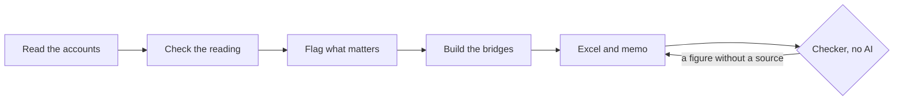
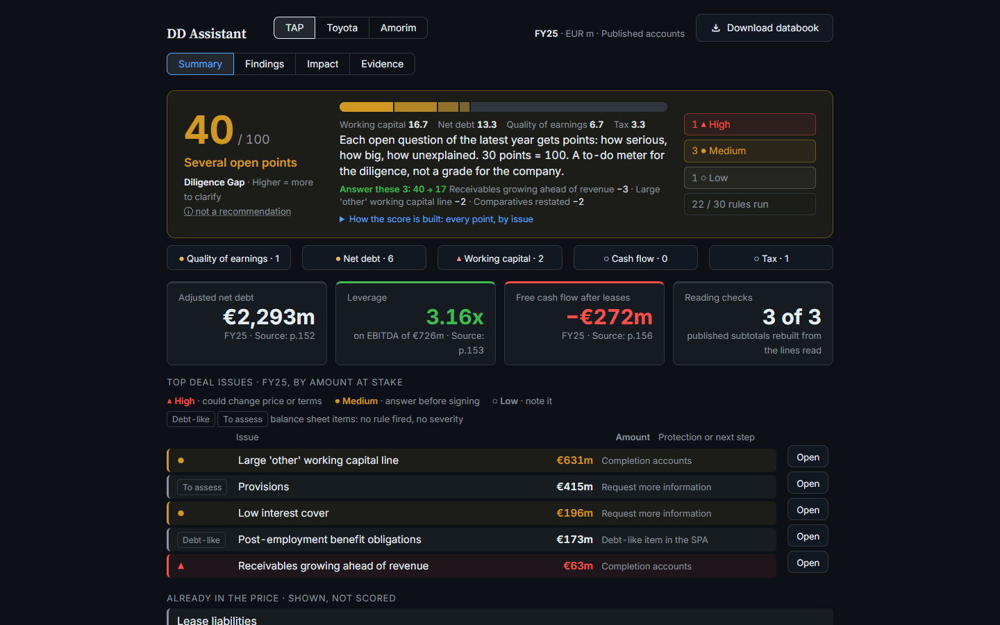
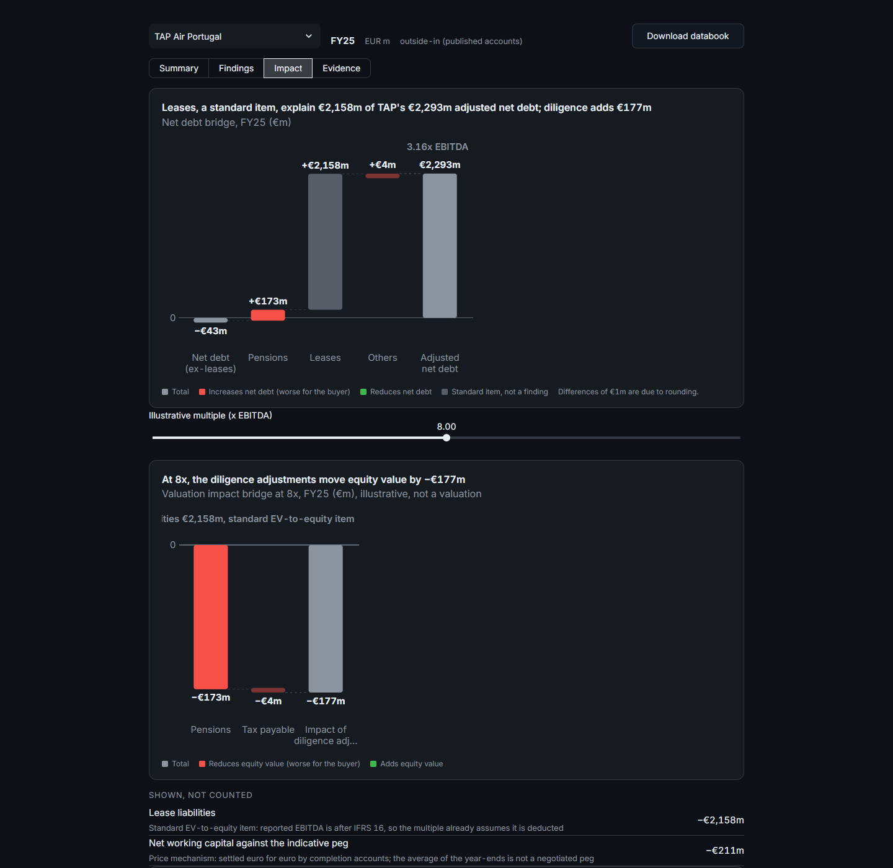
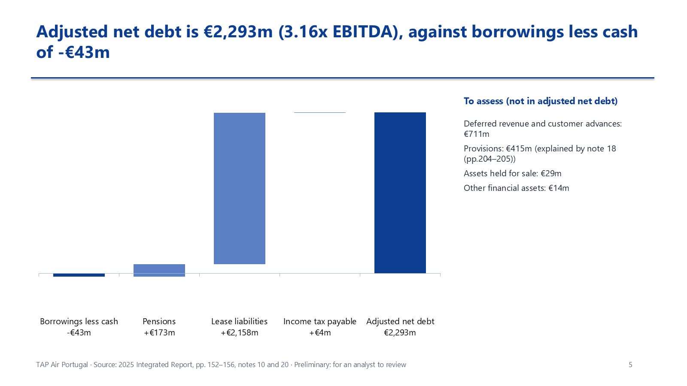
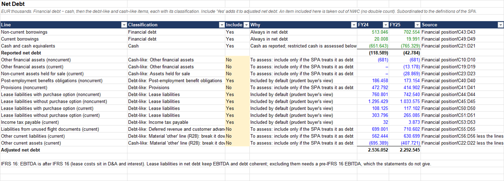

# Architecture and method

How DD Assistant reads a data room, what it computes, how each layer fits and how it is verified. The short version is the [README](../README.md); progress and open gaps are in [`PROGRESS.md`](PROGRESS.md) and [`GAPS.md`](GAPS.md); the detection benchmark is in [`DETECTION.md`](DETECTION.md); publishing is in [`DEPLOY.md`](DEPLOY.md). Earlier phase specifications are kept in [`archive/`](archive/).

## How it works

1. **Read the accounts:** every Excel, PDF, Word and ESEF file of the data room, with a six-language dictionary of statement lines; each figure keeps its file and cell, or its XBRL tag.
2. **Check the reading:** the subtotals the company published are rebuilt from the lines read before any figure is used. A missing figure stays unknown, never zero. Two annual reports give three years; a line that differs between them is a restatement, listed and never mixed in silence.
3. **Flag what matters:** 30 rules from financial due diligence, private equity and bank credit practice, each with its threshold, evidence, source, question for management and document to request. Each finding gets an amount at stake in euros and is ranked by it, with the net debt items, in one list of key issues; below a visible materiality threshold (5% of EBITDA, 1% of revenue) a finding is Low. Each issue carries its typical deal implication: price (EBITDA, net debt, working capital), SPA protection, further diligence or post-deal. The key notes of the report are read too: each issue says whether a note explains it, partly explains it, or leaves it open.
4. **Build the bridges:** reported to diligence-adjusted EBITDA, borrowings less cash to adjusted net debt, and working capital with an indicative peg; then enterprise value to equity, once you enter the price mechanism.
5. **Export and write:** the databook in Excel and the Red Flag Report in slides, whose titles are assembled by rule from the engine's figures; Claude writes the memo and the request list from that material only, and a checker with no AI confirms every figure, for the year it is cited.



The website shows the conclusions (score, top three issues, one chart, coverage); the tool shows the evidence.

## In pictures



*The tool on TAP Air Portugal, Summary: the Diligence Gap in the colour of its band (40 / 100, several open points; higher = more to clarify, not a recommendation), its split by area, the three answers that close most of it (40 → 17), four KPIs coloured by what they mean for a buyer, and the top five deal issues of FY25 tinted by severity. Leases, unflown tickets and the working capital peg sit apart as "Already in the price".*



*Impact, TAP, FY25: leases are a standard item (grey) and explain €2,158m of the €2,293m adjusted net debt; the diligence adds €177m (red). The valuation impact counts only diligence adjustments, at an illustrative multiple.*



*One of the nine slides of the Red Flag Report (PowerPoint, with editable charts): the title states the conclusion with its figure, and the footer gives the source.*



*The databook in Excel: data room figures in blue with their source cell, the analyst's decisions in the yellow cells, and totals that Excel recalculates and the code checks.*

## The Diligence Gap

**How the Diligence Gap works.** Each open issue of the latest year gets points: severity (High 3, Medium 2, Low 1) × materiality (material 1, not quantifiable 0.75, below materiality 0.5) × evidence (open 1, partly explained by a note 0.75, explained 0.5). 30 points = 100, that is ten open, material High findings. A finding that fired only in an earlier year is historical: it stays in Findings with its year, out of the score and the top issues. Materiality is 5% of reported EBITDA for earnings items and 1% of revenue for balance sheet items. Next to the score, the tool names the three issues whose answer lowers it most and the score after them, by the same formula. The Impact view turns the illustrative multiple into euros: EV = multiple × reported EBITDA, equity value = EV − adjusted net debt, and the impact of the findings as a share of that equity value. The request list comes in three priorities (before signing, at most ten; during the diligence; to complete the picture), by severity, amount at stake and SPA impact, each request linked to the finding or rule that asks for it. The score is a triage index, not a probability: issues are ranked by amount at stake, never by points.

## How it is verified, in detail

- **Automated tests** (`python -m unittest`), run on every change.
- **Parity with a hand-built Excel template:** the Python gives exactly the template's metrics, rule values, thresholds and severities.
- **Published totals rebuilt:** on each real company, the subtotals rebuilt from the lines read must equal the published ones, and the balance sheet must balance. Operating profit is rebuilt to the euro for TAP and Toyota Caetano; EBITDA is within the report's own €2k rounding for Corticeira Amorim.
- **No false alarm on a clean company:** a fictitious company designed to pass raises no finding.
- **Memo checker:** every figure of the memo must be in the material, for the period cited; every finding must appear; every question needs a request; no investment-recommendation language. The three demo memos pass with 143, 133 and 138 figures checked, none without a source.
- **Databook:** recalculated by Excel, every total equals the Python value.
- **Detection benchmark:** known distortions are planted one at a time in the real accounts of the three companies (receivables +25%, a disposal gain hidden in other income, a dropped cost line…), with the expected rule written before the run. **48 of 49 were detected** and one was missed. On the first run one of six controls raised an alert it should not have; that rule (R13) was then corrected, and the history is published with every run in [`docs/DETECTION.md`](DETECTION.md).
- **Notes read independently:** a second reader with no access to the transcriptions read 30 figures of the notes from the three reports; all 30 equal the transcribed ones.

**Not measured**

- Time saved against a manual review.
- Distortions nobody thought of, smaller ones, or several at once: the benchmark plants one known distortion at a time.
- Accuracy on companies outside the test set: five sets of real accounts so far. Their 27 findings are classified as 15 true positives, 12 to review and no known false alarm ([`VALIDATION.md`](examples/validation/VALIDATION.md)), a classification proposed by the agent and not yet reviewed by a person: [`REVIEW_SHEET.xlsx`](examples/validation/REVIEW_SHEET.xlsx) is the sheet for that review.

## How you check a result

1. **Data room tab:** every line read, the label it matched and its cell in the published file.
2. **Reading checks:** the subtotals rebuilt from those lines against the ones the company printed.
3. **Red flags:** each finding gives its figures, the source cell and the threshold; for TAP, the report page.
4. **Databook:** open the Excel and follow any total back to its source line; the Checks sheet compares every total with the code.
5. **Memo tab:** the checker's result, run again on the page.

## What it does

Drop a target's data room as the seller sends it — a folder of Excel statements, PDFs and Word documents — and get, in seconds, the first pass of a financial due diligence. It is built for the European market:

- euros only;
- statements in the national formats: Portuguese SNC, Spanish PGC, French PCG, German HGB, Italian civil code, and IFRS in English.

The focus is M&A, buy-side or vendor due diligence. The same analysis also serves a lender's credit review or a health check with no transaction.

What the agent does:

- **Reads the whole data room.** Excel files are read together as one set of statements, every figure keeping its file and cell. PDFs, Word and text documents (management report, audit report, contracts) are read as text for the memo, free and on your computer, and the key-document checklist is ticked from what is there. Statements that exist only as a PDF are read by Claude, on request.
- **Reads ESEF filings.** Every listed company in the EU files its annual report in iXBRL (ESEF), with each figure tagged with its IFRS meaning. Drop the report package (.zip, from [filings.xbrl.org](https://filings.xbrl.org) or the company's website) and every line is read from its tag, exact and free: the company's own lines are understood through their ESEF anchoring to IFRS, and each figure keeps its tag as its source (`ifrs-full:Revenue`).
- **Understands every line.** "Vendas e serviços prestados", "Importe neto de la cifra de negocios", "Chiffre d'affaires", "Umsatzerlöse", "Ricavi delle vendite" and "Revenue" are all revenue. It handles European number, date and unit formats (1.234,5 · 31.12.2024 · TEUR · miles de euros), income statements by nature or by function, and subtotals placed before or after their lines.
- **Checks its own reading.** It rebuilds gross profit, EBITDA and operating profit from the lines it read and compares them with what the company published. A mismatch means a line is missing, and the agent says so.
- **Builds the deal view**, the numbers a deal team asks for first:
  - quality of earnings: reported → management-adjusted → diligence-adjusted EBITDA;
  - net debt, with the debt-like and cash-like items it finds: pensions, TFR, tax payable, leases, shareholder loans, marketable securities;
  - net working capital, with an indicative peg reference.
- **Bridges to the price.** You choose the mechanism of the SPA first; nothing is computed before. Completion accounts: EV + eligible cash − financial debt − debt-like items + (NWC at closing − peg). Locked box: the agreed equity price + value accrual or ticking fee − leakage confirmed after review. Dividends paid in the cash flow statement are listed as leakage candidates, never as a verdict. Sensitivity to the multiple and EBITDA only when EV is derived from a multiple you enter.
- **Exports a databook**, the Excel a transaction team works in: Read Me, Executive Summary, Source Register (every file with its SHA-256), Financials, QoE, NWC, Net Debt, EV to Equity, Leakage, Issues & Requests and Checks. Figures from the data room in blue, formulas in black, links in green; you decide only in the yellow cells (adjustment status, items in net debt, lines in NWC) and the totals follow. On this PC Excel recalculates it and every total equals the Python value.
- **Runs 30 rules**, each explained in plain words with the practice it comes from. Each finding gives evidence with its source, what to investigate, the question for management and the document to request.
  - Thresholds are calibrated for 15 sectors, always with the reason shown.
  - Severity follows size and persistence where it matters: other income inside EBITDA (R04) is measured against EBITDA and is High above a quarter of it; weak cash conversion (R10) is High only when the years analysed together convert less than 70%, since one weak year is often working capital timing.
  - The country of the target, suggested from its legal form (S.G.P.S., S.L., SAS, GmbH, S.p.A.…), sets the accounting framework and the statutory tax rate.
  - The company is compared with European listed peers in its sector, and each sector adds the questions a specialist would ask.

An AI layer — the Claude API, or Claude Code itself with no API key — then writes a two-page memo and the information request list. It does no calculations and creates no findings, and a deterministic checker verifies every figure it writes.

> Sample data:
> - **Duriva**, a fictitious distributor with planted issues, as a data room of five documents;
> - **Velmora**, a fictitious clean company, used to measure false alarms;
> - the published FY2025 accounts of **TAP Air Portugal**, **Toyota Caetano Portugal** and **Corticeira Amorim**, and the FY2024 accounts of the last two;
> - tested on **EDP**'s FY2025 ESEF filing (not included: 96 MB; download it from filings.xbrl.org).

## Why

Much of the first pass in a due diligence is mechanical:
- reading the statements and cross-checking them;
- computing ratios;
- building the EBITDA and net debt bridges;
- spotting movements;
- drafting the request list.

This tool does that part in seconds, with every number traceable to its file and cell. The judgement stays with the analyst: accepting a management adjustment, treating an item as debt-like, confirming the sector, the country and the purpose.

## The rules, in plain words

The full rulebook is in the app (Rulebook tab) and in `python -m dd_assistant --rules`.

| Workstream | Rules | What they check, in plain words |
|---|---|---|
| Revenue quality | R01, R02, R16 | One customer too big; growth from customers who may not stay; a customer listing that does not add up |
| Revenue, acquisitions | R29 | Growth that may come from businesses bought, not like-for-like |
| Quality of earnings | R03–R06, R19, R26, R27 | Margin shifts; other income inside EBITDA; management add-backs; "non-recurring" costs that recur; disposal gains; own work capitalised; D&A growing far ahead of fixed assets |
| Net working capital | R07–R09, R23, R28 | Customers paying later; stock building up; suppliers paid later at year-end; a large "other" line of unknown content |
| Cash flow | R10, R24 | EBITDA not turning into cash; investment below depreciation |
| Net debt and credit | R11, R13, R17, R20, R21, R22 | Debt due soon; cash defined differently; debt missing from the schedule; covenant headroom; high leverage; low interest cover |
| Information quality | R12, R14, R15, R18 | Statements that do not tie; missing documents |
| Tax | R25 | Effective tax rate far from the country's statutory rate |

These are the standard checks of financial due diligence (the Big Four transaction services workstreams), private equity and bank credit. R01–R20 match the reference Excel template exactly; R21–R29 go beyond it (R27–R29 came from what a reviewer found on Toyota Caetano and the rules missed). On the two real companies in the project, the 12 findings are classified as 7 true positives, 5 to review and no known false alarm ([`VALIDATION.md`](examples/validation/VALIDATION.md): a classification proposed by the agent, not yet reviewed by me).

## The layers

| Layer | File | What it does |
|---|---|---|
| Data room | `dataroom.py` | Reads every document at once: merges the Excel files, extracts the text of PDFs and Word files, ticks the document checklist |
| ESEF | `esef.py` | Reads an ESEF report package: tagged facts of the consolidated statements, in the company's order, own lines through their anchoring, euros only |
| Read | `extract.py` | Maps the statements to a standard model with a six-language dictionary. Detects the unit (euros only), the European formats and the P&L presentation; stops at operating profit; flags debt-like and cash-like lines |
| Metrics | `metrics.py` | Growth, concentration, margins, quality of earnings, DSO/DIO/DPO, cash conversion, net debt, leverage, interest cover, capex/D&A, effective tax rate, consistency checks and reading checks |
| Rules | `rules.py` | 30 rules with explicit thresholds, graded severity where size matters, plain-language explanations and their practice |
| Context | `europe.py`, `sectors.py` | 10 European countries (framework, tax rate, legal forms) and 15 sectors (calibration, Damodaran Europe benchmarks, sector lens) |
| Deal view | `deal.py` | Quality of earnings, net debt and working capital bridges; benchmarks; illustrative value at stake |
| Price | `price.py` | Enterprise value to equity: completion accounts, locked box with accrual or ticking fee, leakage register, sensitivity |
| Databook | `databook.py` | The Excel a deal team works in, with formulas, inputs and decisions apart, recalculated by Excel and checked against Python |
| Report | `report.py` | Excel (red flags, deal view, sector, reading checks, metrics, source data) and CSV, with the reviewer's status |
| AI memo | `ai_memo.py` + `ai_memo_prompt.md` | Writes the memo and request list for the chosen purpose; no calculations, no new findings |
| Check | `memo_check.py` | Verifies, without AI, every figure, every finding, every question and the absence of investment recommendations |
| Pipeline | `pipeline.py` | The whole analysis in one call, for the app, the command line and the skill; JSON export |
| App | `app.py` (local) and `tool.py` (public demo) | Local: drop the data room → overview → deal view → red flags → sector → data room → rulebook → memo. Demo (`DD_DEMO=1`): Summary · Findings · Impact · Evidence on the three published cases |

The calculations are deterministic and auditable. The tests (`python -m unittest`) confirm that:
- the Python gives exactly the numbers of the reference Excel template;
- reading the raw data room gives the figures of the hand-filled template, whether it is one workbook or five documents;
- the agent rebuilds the published EBITDA of two real groups exactly;
- it reads Spanish, French, German and Italian statutory accounts correctly;
- it reads an ESEF report package from its tags: precise figures over rounded ones, no segment or half-year figure, the company's own lines through their anchors;
- it raises no false alarm on a clean company;
- a missing figure makes the results that depend on it unknown, never zero;
- the memo checker rejects a figure cited for the wrong year;
- the price cases of the specification (completion accounts, locked box, leakage deducted or claimed) give the expected values;
- the databook recalculated by Excel gives the same totals as Python.

## The agent (Claude Code skill)

`.claude/skills/due-diligence/SKILL.md` turns Claude Code into a due diligence agent that uses this engine as its tools. Open Claude Code in this folder and ask, for example, *"run a due diligence on data/Duriva_data_room"*. The agent:

1. runs the engine and checks the reading first. If a check fails, it finds the line and proposes the correction;
2. confirms the purpose, the country and the sector, and briefs the findings in plain words;
3. asks you to accept or reject each management adjustment;
4. writes the memo itself, with no API key;
5. runs the checker and fixes its own errors until the memo passes.

On Corticeira Amorim the first check caught a rounded figure and the second passed: see [`examples/corticeira-amorim-fy2024/`](examples/corticeira-amorim-fy2024/).

## Install (Windows, PowerShell)

```powershell
py -m venv .venv
.venv\Scripts\Activate.ps1
pip install -r requirements.txt
python -m unittest -v
```

On Windows ARM PCs, use the **x64** Python: Streamlit depends on `pyarrow`, which has no Windows ARM64 build yet.

## Use

```powershell
# the app (runs on this computer only): drop the data room's files
streamlit run app.py

# the online demo, locally: three real companies, no upload, no API
$env:DD_DEMO=1; streamlit run app.py

# a whole data room folder, or files, saved to output\ (Excel and CSV)
python -m dd_assistant data\Duriva_data_room
python -m dd_assistant data\Corticeira_Amorim_2024_published.xlsx --country PT --sector materials

# a listed company's ESEF annual report package (.zip from filings.xbrl.org)
python -m dd_assistant 529900CLC3WDMGI9VH80-2025-12-31.zip

# purpose: buy (default), sell (vendor due diligence), lend (credit review), review (health check)
python -m dd_assistant data\Duriva_data_room --purpose lend

# the reviewer's decisions, corrections and documents received
python -m dd_assistant data\Duriva_data_room --adjustment "Custos de arranque=Accepted" --set orend:2025=60 --received "AR ageing"

# the rulebook, the sectors, JSON and the AI material (free), the memo with the API (paid), the memo check
python -m dd_assistant --rules
python -m dd_assistant --sectors
python -m dd_assistant data\Duriva_data_room --databook
python -m dd_assistant data\Duriva_data_room --json --material
python -m dd_assistant data\Duriva_data_room --memo
python -m dd_assistant data\Duriva_data_room --check-memo memo.md
```

Costs:
- the memo with the API uses Claude Opus 5.5 and costs roughly USD 0.20–0.50 per company; the actual cost is shown at the end;
- reading statements from a PDF also uses the Claude API, roughly USD 0.10–0.40 per document, and always shows the extracted figures for review;
- every other document is read locally, at no cost.

## Results

The FY2025 results of the three demo companies are on the website and in [`examples/`](examples/).

**Real companies (published FY2024 accounts, copied into Excel as printed):**

| Company | Statements | EBITDA rebuilt as | EBITDA |
|---|---|---|---|
| Toyota Caetano Portugal | Portuguese SNC layout, in euros | operating result + D&A | €74,634k |
| Corticeira Amorim | IFRS in English, EUR thousands | operating profit before depreciation | €157,566k |

Both balance sheets reconcile and all reading checks pass. The findings are ones a reviewer would recognise:

- Toyota: material other income, negative operating cash flow in FY23, short-term debt, and capex below depreciation in both years;
- Amorim: weak cash conversion in FY23 and short-dated debt. Cash in the cash flow statement is net of the bank overdrafts of note 19 (€48,672k in FY24): the agent reconciles it instead of flagging it.

The deal view finds pensions and income tax payable as debt-like items in both groups.

**Duriva** (five documents): 15 findings, identical to the single-workbook version. Management-adjusted EBITDA is €1,870k. Diligence-adjusted EBITDA is €1,165k until the adjustments are supported: the €250k disposal gain inside other income is removed. Other findings include:

- a 23.8% customer concentration;
- a one-off sale presented as growth;
- cash conversion of 20.5%;
- 55% of debt due within 12 months.

**Velmora (clean company):** no analytical findings, with the general thresholds, with its sector's and with the 30 rules.

**EDP (ESEF FY2025, read from the tags):** operating profit rebuilt to the thousand euros in both years (€2,999,414k in FY25, €2,261,983k in FY24), with the share of joint ventures inside it as EDP presents it. The country (Portugal) comes from the report itself and the sector is suggested as energy & utilities. Seven findings: other income at 17% of EBITDA (EDP's gains on asset rotation sit there), cash conversion of 67% in FY25 (Medium: 81% over the two years), leverage of 3.6x, interest cover of 2.6x, an effective tax rate of 36.7% in FY24, large "other" working capital lines, and the documents a listed report does not contain. Tax equity partnerships in North America and collateral deposits are shown as items to assess in net debt.

**Spanish, French, German and Italian accounts:** synthetic statements in each national layout are read correctly, operating profit is rebuilt exactly, the balance sheet balances and no false alarm is raised (`tests/test_europe.py`). Real statutory accounts in these formats have not been tested yet.

## Scope

This is a preliminary **financial** due diligence on annual statements in euros. It does not cover:

- legal, tax, commercial, IT or HR due diligence;
- contract review;
- valuation (the price bridge takes the EV or the multiple you enter; it never suggests one);
- statements in other currencies (an ESEF report in another currency is refused too).

Monthly, LTM and budget figures are not in annual accounts. The request list asks for them, and the working capital peg reference is labelled indicative for that reason. Leakage is a screening register: without the SPA and a register of payments the conclusion is "evidence insufficient". The price bridge is a model configuration subordinated to the SPA definitions. Open gaps are listed in [`GAPS.md`](GAPS.md). Sector benchmarks come from European listed groups and are orientation, never a finding on their own. Every threshold, calibration and benchmark is visible in the app, the Excel and `--rules` / `--sectors`.

## Sources

- TAP Air Portugal, Toyota Caetano Portugal and Corticeira Amorim statements: each file's *Source* sheet gives the URL, the pages or statement titles, and the date obtained.
- Sector benchmarks: Damodaran Online (NYU Stern), European industry datasets, January 2026; regenerate them with `scripts/sector_benchmarks.py`.
- Statutory tax rates: headline 2024 rates with usual local surcharges (`dd_assistant/europe.py`), for a plausibility test only.

## Glossary

| Term | In one sentence |
|---|---|
| QoE | Quality of earnings: how much of the reported profit is recurring and supported by evidence. |
| EBITDA | Earnings before interest, tax, depreciation and amortisation: operating profit before the cost of assets and financing. |
| Diligence-adjusted EBITDA | EBITDA after the adjustments the reviewer accepts: what a buyer would price. |
| Net debt | What the company owes to lenders, less its cash; a buyer deducts it from the value of the business. |
| Debt-like item | An obligation that is not a bank loan but behaves like one (leases, pensions, tax due), so it is deducted from the price. |
| IFRS 16 | The lease standard: future lease payments are shown as debt, and their cost leaves EBITDA. |
| NWC | Net working capital: stock plus money owed by customers, less money owed to suppliers and similar items. |
| Peg | The normal level of working capital agreed in the sale contract; a difference at closing changes the price. |
| Completion accounts | A price fixed on the balance sheet at closing, with net debt and working capital trued up. |
| Locked box | A price fixed on a past balance sheet; the buyer is protected against value leaving the company (leakage). |
| Red flag | A finding a rule raised: a figure beyond a threshold that needs an explanation from management. |
| Materiality | The size below which an item does not change the reader's view: here 5% of EBITDA for earnings items and 1% of revenue for balance sheet items, and you can change it. |
| Amount at stake | The euros behind a finding, computed from the lines that made the rule fire. |
| Deal implication | What a deal team typically does with an issue: change the price, protect itself in the contract, ask for more, or plan for it after the deal. |
| SPA | Share purchase agreement: the contract for the sale of the company. |
| DSO / DIO / DPO | Days of sales outstanding, inventory outstanding and payables outstanding: how long customers take to pay, stock stays, and the company takes to pay suppliers. |
| ESEF | European Single Electronic Format: the tagged annual report EU listed companies must publish. |
